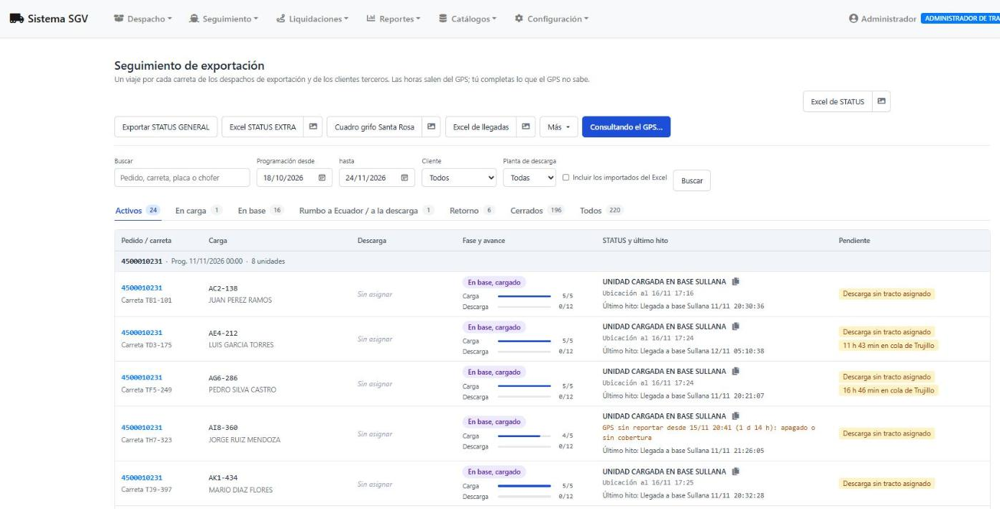
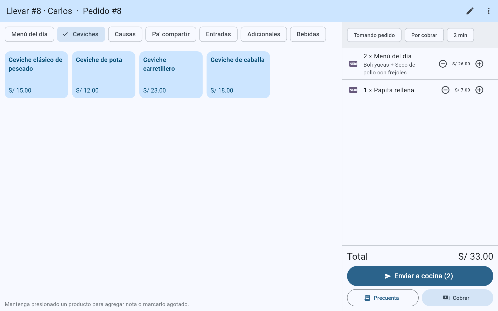
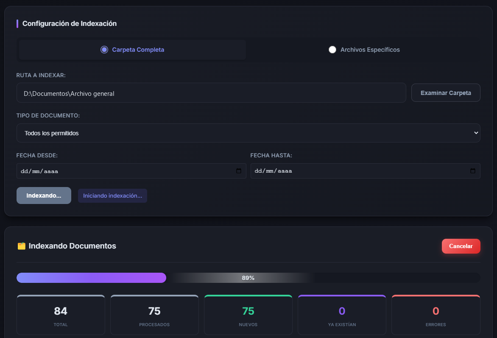
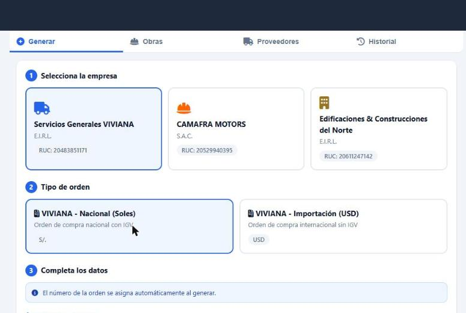

 

## Proyectos principales

### [WebSGV](https://github.com/nickdream21/SGT-Sgv)

Sistema de gestión operativa para una empresa de transporte y construcción. Administra despachos, órdenes de viaje, liquidaciones, abastecimiento y reportes, con control de acceso por roles y registro de auditoría.

`C#` `ASP.NET` `SQL Server`

 
 

### [A Mar Pedidos](https://github.com/nickdream21/restaurantAmbar)

Sistema de punto de venta para un restaurante. Gestiona pedidos de mesa, para llevar y delivery, cobros con múltiples medios de pago y cierre de caja. Opera sin conexión a internet e imprime comandas en impresoras térmicas en red.

`Flutter` `SQLite` `ESC/POS`

 
 

### [Krawl](https://github.com/nickdream21/Krawl)

Aplicación de escritorio para la gestión documental. Extrae e indexa el contenido de archivos PDF, Word, Excel y documentos escaneados mediante OCR, con integración a Google Drive y actualizaciones automáticas. 13 versiones publicadas.

`Electron` `Node.js` `Python`

 
 

### [Órdenes de Compra](https://ordenes-compra-sgvcm.vercel.app)

Aplicación web para la emisión, numeración correlativa y archivo de órdenes de compra y de servicio en PDF para tres empresas, con autenticación y almacenamiento en la nube. [Código fuente](https://github.com/nickdream21/OrdenesCompraSGVCM).

`Node.js` `Supabase` `Vercel`

 
 

<b>Otros proyectos</b>

 

- [botSGV](https://github.com/nickdream21/botSGV): asistente en Telegram que responde consultas gerenciales en lenguaje natural a partir de la base de datos operativa (Python, SQL Server).
- [Reconocimiento Facial](https://github.com/nickdream21/reconocimientoFacial): modelo de reconocimiento facial basado en transfer learning con MobileNetV2 (TensorFlow, OpenCV).
- [Sistema de Alquiler](https://github.com/nickdream21/sistema-alquiler-vehiculos): sistema de gestión de alquiler de vehículos con arquitectura cliente-servidor (React, Node.js, SQL Server).
- [Dmovil](https://github.com/nickdream21/Dmovil): aplicación nativa para Android (Kotlin).
- [2FA System](https://github.com/nickdream21/2fa-sys): módulo de autenticación de dos factores (C#).

