  

<b>Otros proyectos</b>

 

- [botSGV](https://github.com/nickdream21/botSGV): asistente en Telegram que responde consultas gerenciales en lenguaje natural a partir de la base de datos operativa (Python, SQL Server).
- [Reconocimiento Facial](https://github.com/nickdream21/reconocimientoFacial): modelo de reconocimiento facial basado en transfer learning con MobileNetV2 (TensorFlow, OpenCV).
- [Sistema de Alquiler](https://github.com/nickdream21/sistema-alquiler-vehiculos): sistema de gestión de alquiler de vehículos con arquitectura cliente-servidor (React, Node.js, SQL Server).
- [Dmovil](https://github.com/nickdream21/Dmovil): aplicación nativa para Android (Kotlin).
- [2FA System](https://github.com/nickdream21/2fa-sys): módulo de autenticación de dos factores (C#).

